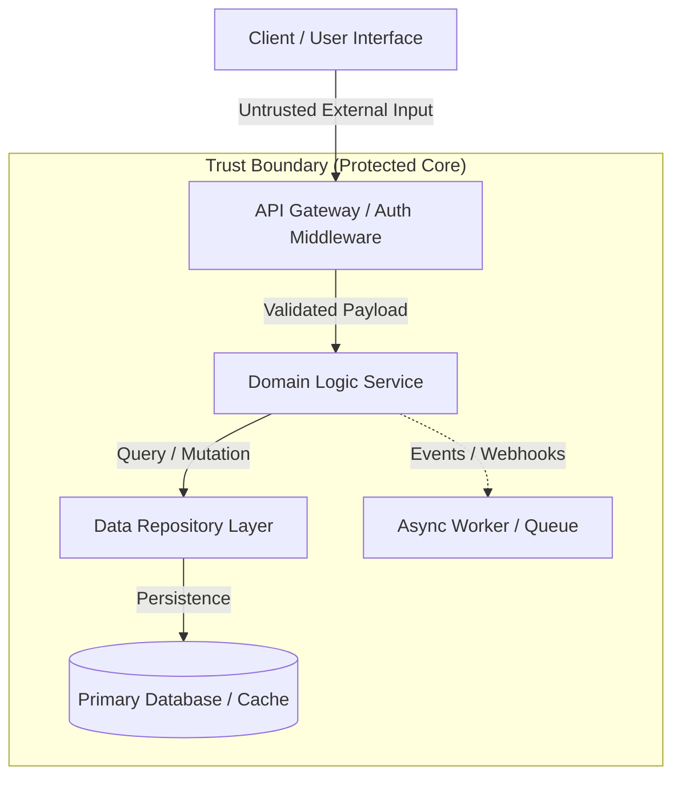

# System Architecture Map

> High-level map of modules, services, and trust boundaries (Habits 06, 20). Keep to one page.
> Sync with Graphify AST codebase graph.

## Modules & Ownership
- **Interface / Presentation:** UI components, views, CLI entry points, and static assets.
- **API / Edge Gateway:** Request routing, input schema validation, rate limiting, and authentication.
- **Domain Services:** Core business rules, calculation engines, and service orchestrators.
- **Data & Persistence Layer:** Database models, migrations, caches, and repository abstractions.
- **External Integrations:** Third-party APIs, webhooks, and asynchronous message queues.

## Trust Boundaries
- **External Untrusted Boundary:** Public internet requests (browsers, mobile clients, webhooks) entering the API Gateway.
- **Internal Domain Boundary:** Sanitized internal calls between services within the application boundary.
- **Data Storage Boundary:** Reads and writes executed through isolated repository queries and migrations.

## System Map Diagram

