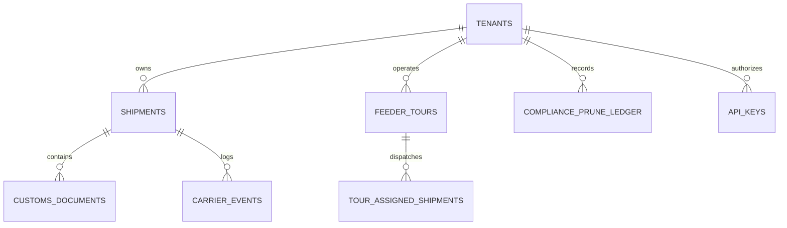

# Data Structures & Schemas
# Schäfer & SIS Interlogistik (S-Group Gateway)

> Record core structures, access patterns, scale, and permissions (Habit 20).
> Every table has an engineering rationale and an explicit lock stopping data corruption or cross-tenant leakage.

---

## 1. Relational Architecture Map

The S-Group Gateway uses an ACID-compliant PostgreSQL relational architecture organized around multi-tenant partitioning (`tenant_id`).

---

## 2. Core Relational Tables & Invariants

### 1. `tenants` (Multi-Tenant Partition Root)
- **Shape:** `tenant_id` (PK, VARCHAR 64), `company_name`, `country_code` ('DE'), `is_active`, `created_at`.
- **Access Pattern:** Read-heavy on authentication, cached in-process.
- **Invariant:** Strict tenant isolation anchor. Foreign key cascades restrict deletion if active records exist.

### 2. `shipments` (Freight Master Records)
- **Shape:** `shipment_id` (PK), `tenant_id` (FK), `carrier_code`, `tracking_reference`, `origin`, `destination`, `cargo_description_de`, `cargo_description_en`, `weight_kg`, `current_status`, `estimated_delivery`, `created_at`.
- **Access Pattern:** Read-heavy (90% reads, 10% writes from webhook ingestion).
- **Growth:** ~50,000 to 200,000 active shipments per year.
- **Indexes:** Composite B-Tree `(tenant_id, created_at DESC)` and `(tenant_id, current_status)`.

### 3. `customs_documents` (ATLAS & CMR Archive)
- **Shape:** `doc_id` (PK), `shipment_id` (FK), `tenant_id` (FK), `doc_type`, `title_de`, `title_en`, `file_number`, `verified_date`, `file_size_kb`.
- **Access Pattern:** Read on customer demand during customs verification or transport audits.
- **Invariant:** Scoped by `tenant_id` to prevent cross-tenant document theft.

### 4. `carrier_events` (Milestone Timeline & Telematics)
- **Shape:** `event_id` (PK), `tenant_id` (FK), `shipment_id`, `carrier_code`, `raw_event_code`, `normalized_milestone`, `location`, `latitude`, `longitude`, `timestamp`, `created_at`.
- **Access Pattern:** High write frequency from carrier webhooks; chronological ordered reads.
- **Privacy Retention Rule (DSGVO Art. 5):** Pruned automatically after 90 days. Dedicated B-Tree index on `(timestamp)` ensures high-speed sub-millisecond retention sweeps.

### 5. `feeder_tours` (Multi-Modal Fleet & Capacity Constraints)
- **Shape:** `tour_id` (PK), `tenant_id` (FK), `tour_title_de`, `tour_title_en`, `transport_mode`, `corridor`, `origin`, `destination`, `vehicle_identifier`, `driver_pseudonym`, `departure_time`, `estimated_arrival`, `status`, `max_pallets`, `loaded_pallets`, `max_weight_kg`, `loaded_weight_kg`, `adr_hazardous_class`.
- **Physical Safety Invariants (PostgreSQL Engine Level):**
  - `CONSTRAINT check_pallet_capacity CHECK (loaded_pallets >= 0 AND loaded_pallets <= max_pallets)`
  - `CONSTRAINT check_weight_capacity CHECK (loaded_weight_kg >= 0 AND loaded_weight_kg <= max_weight_kg)`
- **Privacy Rule:** Driver names are strictly prohibited. Column `driver_pseudonym` stores worker token (e.g. `DRV-HAM-491`).

### 6. `compliance_prune_ledger` (Immutable Audit Trail)
- **Shape:** `sweep_id` (PK), `tenant_id` (FK), `executed_at`, `retention_cutoff`, `records_evaluated`, `records_purged`, `status`, `audit_hash`.
- **Access Pattern:** Append-only ledger; read during German privacy and ISO 27001 regulatory audits.
- **Invariant:** `audit_hash` stores SHA-256 cryptographic proof of the sweep payload.

### 7. `api_keys` (Enterprise Credentials & Scoped RBAC)
- **Shape:** `api_key_id` (PK), `hashed_key` (SHA-256, UNIQUE), `principal_id`, `tenant_id` (FK), `role`, `scopes` (JSONB array), `description`, `is_active`, `created_at`.
- **Access Pattern:** Constant-time hash lookup per API request.
- **Invariant:** Never stores raw plaintext keys; only stores SHA-256 digests.

---

## 3. Migration Versioning & Ledger (`schema_migrations`)

All schema changes are tracked in `schema_migrations` with cryptographic SHA-256 checksums to detect file drift:

| Version | Migration Name | Purpose |
| :--- | :--- | :--- |
| `V001` | `init_tenants_and_shipments` | Tenants, shipments, and composite indexes |
| `V002` | `customs_documents_and_carrier_events` | Customs archive and telematics events |
| `V003` | `feeder_dispatch_tours` | Feeder tours with physical load CHECK constraints |
| `V004` | `compliance_audit_ledger` | Immutable DSGVO Art. 5 pruning sweep receipts |
| `V005` | `api_keys_and_credentials` | Hashed API keys with JSONB permission scopes |
